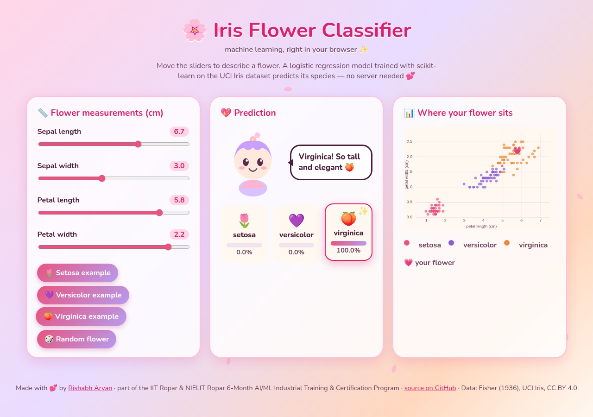
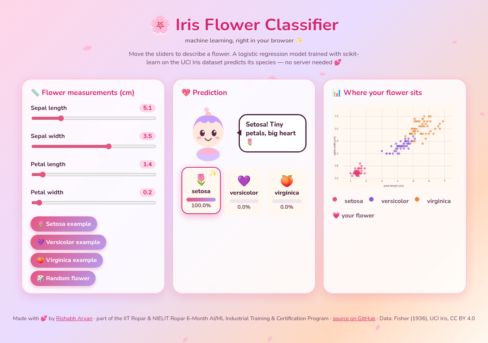
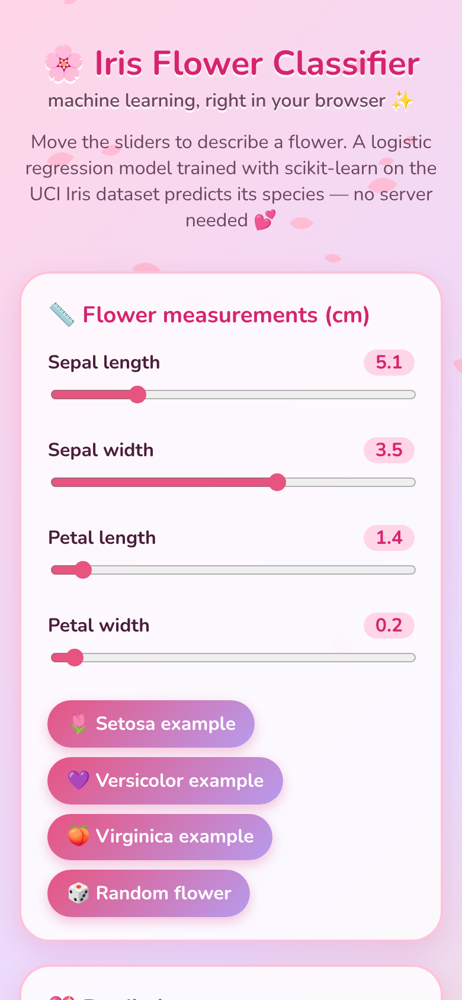
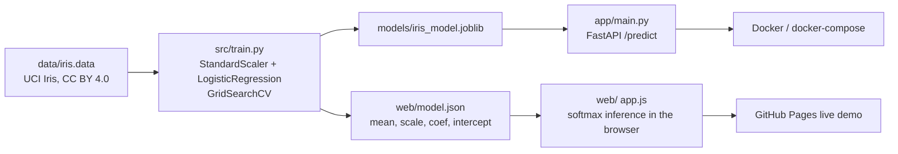

<div align="center">

# 🌸 Iris Flower Classification — Machine Learning in Python (scikit-learn, FastAPI) with a Live In-Browser Demo

[](https://rishabh-bgp.github.io/iris-classification/)
[](https://github.com/Rishabh-bgp/iris-classification/actions/workflows/ci.yml)


**[▶ Try the live demo](https://rishabh-bgp.github.io/iris-classification/)**



</div>

An end-to-end **machine learning project in Python**: exploratory data analysis of the classic **UCI Iris dataset**,
comparison of eight **scikit-learn** classifiers with stratified cross-validation, hyperparameter tuning, evaluation,
interpretation, a **FastAPI `/predict` REST API**, **Docker** deployment, **GitHub Actions CI** and an interactive web demo
on **GitHub Pages** where the trained model runs entirely in your browser (JavaScript inference from exported parameters).

> Research work carried out as part of the **6-Month Industrial Training & Certification Program in Artificial Intelligence and Machine Learning**, jointly offered by [IIT Ropar](https://www.iitrpr.ac.in/) and [NIELIT Ropar](https://www.nielit.gov.in/ropar/), under MeitY, Govt. of India.

---

## 📈 Results (from the executed notebook)

10-fold stratified cross-validation, default hyperparameters, standard scaling in each pipeline:

| Model | CV accuracy | SD |
|---|---|---|
| LDA | **0.973** | 0.044 |
| K-nearest neighbours | 0.960 | 0.053 |
| SVM (RBF) | 0.960 | 0.044 |
| Logistic regression | 0.953 | 0.052 |
| Random forest | 0.953 | 0.052 |
| Gaussian naive Bayes | 0.953 | 0.052 |
| Decision tree | 0.933 | 0.052 |
| Majority baseline | 0.333 | 0.000 |

**Tuning (GridSearchCV, same folds):** logistic regression 0.973 (C = 100) · KNN 0.973 (k = 13) · SVM 0.967 (C = 1, γ = 0.1).

**Deployed model — tuned logistic regression:**
* Out-of-fold accuracy **0.973** (150 flowers); macro F1 0.973. Setosa 1.000 F1; versicolor 0.959; virginica 0.961.
* Stratified 70/30 hold-out: accuracy 0.911 (45 flowers) — a small split, so noisier than CV.
* Most informative features: petal length and petal width (random-forest importances 0.455 and 0.417; largest
  logistic-regression coefficients).

**Browser ↔ Python check:** the JavaScript model on the live page reproduces scikit-learn's `predict_proba` on all 150
flowers with a maximum absolute difference of 4.4 × 10⁻¹⁶ and 100% label agreement.

Details: [docs/results.md](docs/results.md).

## 🖼️ Screenshots

| Desktop | Mobile |
|---|---|
|  |  |

## 🏗️ Architecture



## 📂 Repository structure
```
notebooks/iris_classification.ipynb   EDA, preprocessing, model comparison, tuning, evaluation, interpretation
src/data.py, src/train.py             data loading; training + export (joblib and JSON)
app/main.py                           FastAPI app: GET /health, POST /predict
tests/test_api.py                     pytest: API, validation, dataset, JSON-export parity with scikit-learn
web/                                  static demo (index.html, style.css, app.js, model.json, iris.json)
Dockerfile, docker-compose.yml        local deployment (API on :8000, demo on :8080)
.github/workflows/ci.yml              CI: ruff + pytest on Python 3.12 and 3.13
gh-pages branch                       published copy of web/ served by GitHub Pages
docs/                                 extended documentation
```

## 🚀 Run locally
```bash
git clone https://github.com/Rishabh-bgp/iris-classification.git
cd iris-classification
python -m venv .venv && source .venv/bin/activate
pip install -r requirements-dev.txt
python -m src.train                       # trains, writes models/ and web/model.json
pytest -q                                 # 6 tests
uvicorn app.main:app --reload             # API at http://localhost:8000/docs
python -m http.server -d web 8080         # demo at http://localhost:8080
```

## 🐳 Docker
```bash
docker compose up --build                 # API → http://localhost:8000 · demo → http://localhost:8080
```

## 🔌 API
```bash
curl -X POST http://localhost:8000/predict -H "Content-Type: application/json" \
  -d '{"sepal_length":5.1,"sepal_width":3.5,"petal_length":1.4,"petal_width":0.2}'
```
Returns `{"species": "Iris-setosa", "probabilities": {...}}`. Interactive docs at `/docs`. See [docs/api.md](docs/api.md).

## 📚 Documentation
| Page | Contents |
|---|---|
| [docs/data.md](docs/data.md) | Dataset, attribution, licence |
| [docs/methodology.md](docs/methodology.md) | Pipeline, models, validation, tuning |
| [docs/results.md](docs/results.md) | Full results and interpretation |
| [docs/api.md](docs/api.md) | REST API reference |
| [docs/web-demo.md](docs/web-demo.md) | How in-browser inference works; design and accessibility |
| [docs/deployment.md](docs/deployment.md) | Docker, compose, CI, GitHub Pages |
| [docs/faq.md](docs/faq.md) | FAQ and limitations |

## ⚖️ Licence
Code and docs: MIT © 2026 Rishabh Aryan. Iris data: CC BY 4.0 — Fisher, R. A. (1936), UCI Machine Learning Repository,
doi:10.24432/C56C76.

## 🔗 Other repositories by Rishabh Aryan

| Repository | Description | Live |
|---|---|---|
| [100-days-of-python](https://github.com/Rishabh-bgp/100-days-of-python) | My original, offline, no-API-key solutions to all 100 projects of the 100 Days of Code Python bootcamp curriculum… | — |
| [Agentic-Engineering-Ebook](https://github.com/Rishabh-bgp/Agentic-Engineering-Ebook) | Agentic Engineering is a practical notebook-book on specifying, generating, verifying, and refining multi-tenant… | — |
| [beed-ml-study](https://github.com/Rishabh-bgp/beed-ml-study) | Provenance audit and leakage-aware benchmark of seizure-type classifiers on the Bangalore EEG Epilepsy Dataset — IIT… | — |
| [Brain-Computer-Interfaces-and-Cognitive-Computing-An-Introduction](https://github.com/Rishabh-bgp/Brain-Computer-Interfaces-and-Cognitive-Computing-An-Introduction) | Brain–computer interfaces (BCIs) link neural activity to external devices, translating brain signals via algorithms… | — |
| [building-a-virtual-cell-in-python](https://github.com/Rishabh-bgp/building-a-virtual-cell-in-python) | A cell has a normal gene-activity pattern. Knock out one gene and that pattern changes. This project trains a small… | — |
| [Chronic-Kidney-Disease-Stage-Identification-in-HIV-Infected-Patients-Using-Supervised-ML](https://github.com/Rishabh-bgp/Chronic-Kidney-Disease-Stage-Identification-in-HIV-Infected-Patients-Using-Supervised-ML) | ML is transforming Chronic Kidney Disease (CKD) detection in HIV patients, catching early asymptomatic stages to… | — |
| [cobratate](https://github.com/Rishabh-bgp/cobratate) | Cobratate, an esoteric imperative programming language. Tate-flavored syntax, ordinary semantics, and a Python… | [open](https://rishabh-bgp.github.io/cobratate/) |
| [coda-synth](https://github.com/Rishabh-bgp/coda-synth) | CoDA-Synth: stylometric detection of LLM-rewritten dark-web documents with sparse TF-IDF + LinearSVC. Research lab,… | [open](https://shale-ember-delta-kite.grok.me/) |
| [IIT-ROPAR-GENAI-FOUNDATIONS](https://github.com/Rishabh-bgp/IIT-ROPAR-GENAI-FOUNDATIONS) | Free open-source Generative AI foundations ebooks (2026) covering Claude, Grok, Gemini, Cursor, OpenAI and more —… | — |
| [kbc-game](https://github.com/Rishabh-bgp/kbc-game) | Kaun Banega Crorepati (KBC) quiz game for the terminal in Python: 16-question prize ladder, safe levels and 4… | — |
| [knn-classifier](https://github.com/Rishabh-bgp/knn-classifier) | Simple K-Nearest Neighbors classifier on the classic Iris dataset using scikit-learn. Loads data, trains the model,… | — |
| [linear-regression-model-](https://github.com/Rishabh-bgp/linear-regression-model-) | Supervised linear regression on the scikit-learn diabetes dataset. A single feature (BMI) is used to predict… | — |
| [logistic-regression](https://github.com/Rishabh-bgp/logistic-regression) | This graduate capstone applies multi-class logistic regression to the Iris dataset. It includes EDA, stratified… | — |
| [logistics-website-capstone](https://github.com/Rishabh-bgp/logistics-website-capstone) | Logistics website capstone: Kargonaut Logistics, a premium freight site mixing claymorphism, glassmorphism and… | [open](https://rishabh-bgp.github.io/logistics-website-capstone/) |
| [lovelight-leap](https://github.com/Rishabh-bgp/lovelight-leap) | 💖 Lovelight Leap: a love-themed 2D platformer in vanilla JS canvas. 4 worlds, a boss you cheer up, original… | [open](https://rishabh-bgp.github.io/lovelight-leap/) |
| [machine-learning-part-1](https://github.com/Rishabh-bgp/machine-learning-part-1) | Machine learning in Python with scikit-learn: heart disease classification and medical insurance cost regression… | — |
| [Meeting-of-Machines-Consumer-Agents-Seller-Agents-and-Hidden-Fulfilment-Risk-in-Online-Retail](https://github.com/Rishabh-bgp/Meeting-of-Machines-Consumer-Agents-Seller-Agents-and-Hidden-Fulfilment-Risk-in-Online-Retail) | Agentic commerce lets shopping and seller agents place orders without showing operational truth. This IS case argues… | — |
| [morocco-city-aware-load-forecasting](https://github.com/Rishabh-bgp/morocco-city-aware-load-forecasting) | City-aware short-term load forecasting and peak detection on high-resolution Moroccan smart-meter data (5 zones).… | — |
| [NIELIT-DATA-SCIENCE](https://github.com/Rishabh-bgp/NIELIT-DATA-SCIENCE) | Hands-on NumPy, Pandas, and Matplotlib Jupyter notebooks for the NIELIT Data Science curriculum — practical,… | — |
| [NIELIT-MACHINE-LEARNING-PROJECTS](https://github.com/Rishabh-bgp/NIELIT-MACHINE-LEARNING-PROJECTS) | Nineteen end-to-end machine learning projects: classification, regression, clustering, and recommendation, with… | — |
| [NIELIT-PYTHON-](https://github.com/Rishabh-bgp/NIELIT-PYTHON-) | Open-source Python teaching notebooks: a language reference and five capstone programs, with detailed documentation.… | — |
| [pan-cancer-classification](https://github.com/Rishabh-bgp/pan-cancer-classification) | Leakage, equivalence, conformal reliability and data efficiency on the UCI TCGA Pan-Cancer RNA-Seq dataset — IIT… | — |
| [Predicting-Hot-Events-in-the-Early-Period-through-Bayesian-Model-for-Social-Networks](https://github.com/Rishabh-bgp/Predicting-Hot-Events-in-the-Early-Period-through-Bayesian-Model-for-Social-Networks) | This notebook details the implementation and evaluation of a Bayesian perspective Early stage Event Prediction… | — |
| [prediction-as-power](https://github.com/Rishabh-bgp/prediction-as-power) | Laboratory and working paper on prediction as power in European electricity markets. A DE-like hourly simulator… | — |
| [snakes-and-ladders](https://github.com/Rishabh-bgp/snakes-and-ladders) | 🐍🪜 Original Snakes & Ladders browser game: hand-drawn SVG snakes and ladders, 3D dice, 2-4 humans or bots, sound,… | [open](https://rishabh-bgp.github.io/snakes-and-ladders/) |
| [spam-scan](https://github.com/Rishabh-bgp/spam-scan) | Explainable spam, phishing & Indian-scam detector for SMS/email (English, Hindi, Hinglish): TF-IDF + Logistic… | [open](https://spam-scan.onrender.com) |
| [vedic-math-hybrid-kt](https://github.com/Rishabh-bgp/vedic-math-hybrid-kt) | Hybrid Vedic Math AI: rule-based sutras (Urdhva-Tiryagbhyam, Nikhilam, Yavadunam) plus RF classifier that cleans… | — |
| [wind-turbine-power-model](https://github.com/Rishabh-bgp/wind-turbine-power-model) | Single-turbine power curves + wind-farm simulation. Weibull wind stats, hourly NASA-style speed data, and… | — |
| [zoo-website-capstone](https://github.com/Rishabh-bgp/zoo-website-capstone) | Capstone project: a fictional zoo website built twice — a beginner-style simple version and a cinematic advanced… | [open](https://rishabh-bgp.github.io/zoo-website-capstone/) |
